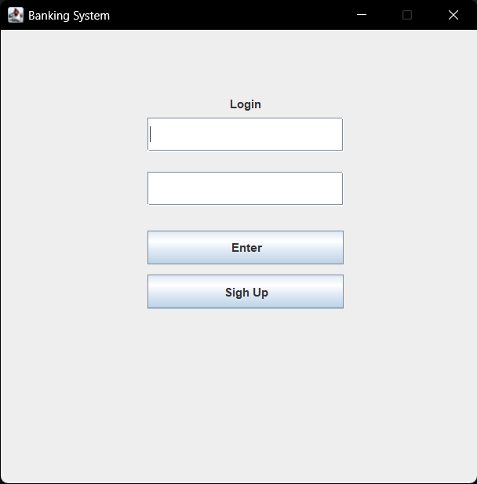
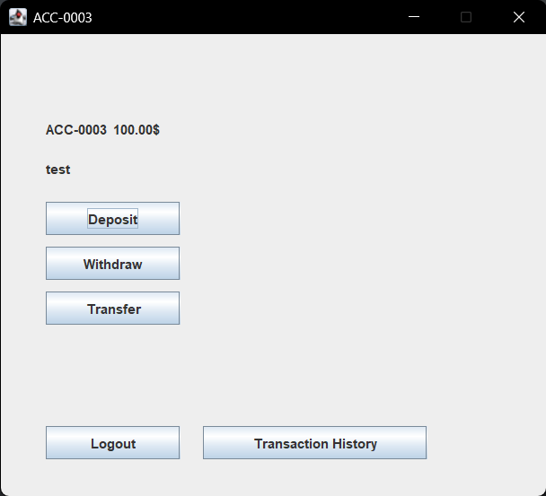
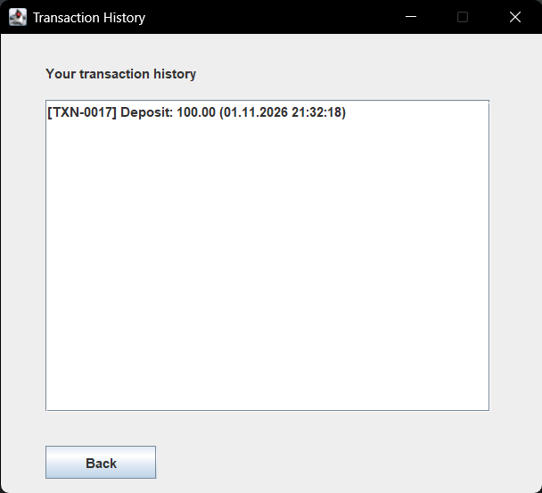

# Banking System
A small banking app I wrote in Java to practice what I learned in my first year
of CS. It has a Swing GUI and stores everything in MySQL.

## What it does
You can sign up, log in, and open a checking account (with an overdraft limit)
or a savings account (with an interest rate). From the dashboard you can deposit,
withdraw, transfer money to another account, and look at your transaction history.

## How it's built
The code is split into a few layers so the GUI doesn't talk to the database directly:
- `gui` has the Swing windows
- `domain_models` has the accounts, transactions, the service with the business logic,
  and the repositories that read and write the data
- `exceptions` has custom exceptions like InsufficientFundsException

Made with Java, Swing, JDBC, MySQL and JUnit 5.

 ## Known limitations
- Passwords are stored as plain text and should be hashed
- A transfer is two separate operations, so it can fail halfway
- Money is stored as `double` (`BigDecimal` would be better)
- The database password is hardcoded
- No Maven or Gradle yet

## Screenshots

